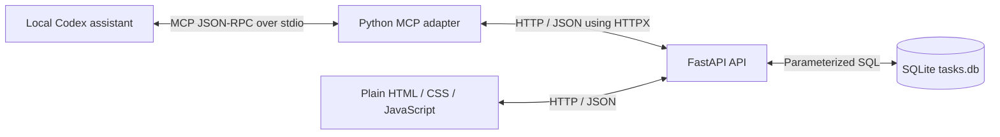

# Architecture and implementation decisions

## One application, two interfaces

Only the API opens SQLite. The MCP adapter cannot bypass the application's
validation or create a separate set of records. The browser reads and writes
through the same API. The assistant is an external client, not another backend.

## File responsibilities

| File | Responsibility |
| --- | --- |
| `models.py` | Shared input/output contract; trimmed text, real dates, allowed fields, sparse updates |
| `database.py` | Database path resolution, one table, short-lived connections, transactional SQL |
| `app.py` | API lifecycle, routes, error mapping, local browser policy, static files |
| `mcp_server.py` | Four stdio tools, strict argument-name checks, HTTP requests and tool errors |
| `static/index.html` | Accessible page structure, task creation, filters, edit dialog |
| `static/styles.css` | Local design tokens, layout, responsive presentation, focus visibility |
| `static/app.js` | Real API requests, safe text rendering, create/edit/complete/reopen interactions |
| `tests/test_uniplan.py` | API acceptance checks and real-process MCP integration check |
| `scripts/smoke_mcp.py` | Reusable isolated protocol demonstration and process lifecycle checks |

## Why these choices

- **FastAPI + Pydantic:** one clear contract, generated API documentation, standard 422 validation errors.
- **SQLite + sqlite3:** persistent local data with no database service or ORM to configure.
- **One connection per operation:** synchronous FastAPI routes can run on worker threads without
  sharing a thread-bound connection. Connections commit/roll back and always close.
- **Atomic updates:** `UPDATE ... RETURNING` changes only supplied fields and returns that write's
  stored row. `AUTOINCREMENT` gives database-generated, stable IDs. SQLite 3.35+ is required.
- **Sparse updates:** `model_dump(exclude_unset=True)` distinguishes omission from explicit null.
- **HTTPX async adapter:** four small tools reuse one request helper with a 10-second timeout,
  no redirects/retries, and local proxy bypass. Expected HTTP/network failures raise `ToolError`.
- **Official MCP SDK v2:** use `MCPServer`, not v1's `FastMCP`. v2 uses snake_case result attributes.
  The SDK installs `httpx2` for its internal needs; this adapter explicitly depends on `httpx`
  for the separate application HTTP calls. Those clients are not passed into SDK transports.
- **Strict tool names/fields:** a tiny `MCPServer` subclass uses public `list_tools`/`call_tool`
  methods to reject unknown top-level arguments, which the installed SDK otherwise discards.
  Nested changes use the same strict Pydantic model as the API.
- **Plain frontend:** same-origin static files, no build system, no external fonts/CDNs,
  no duplicated persistence. A refresh is explicit instead of adding polling or WebSockets.

## Validation and safety boundaries

SQL values use placeholders. Dynamic SQL column names come from a fixed internal
allowlist. Text is rendered with `textContent`, never injected into HTML.
Host checks block unrecognized hostnames, and an Origin check rejects browser
writes from a different origin. The page uses a restrictive Content Security Policy.
The API's OpenAPI documentation is allowed its own assets.

These are modest protections for a local prototype. There is no authentication
or multi-user isolation; do not expose the server to a LAN or the Internet.
Local programs can call the API. SQLite failures are logged locally and return 503.

The browser sends only edited fields from its dialog, preserving unrelated fields
changed through MCP during editing. Concurrent edits to the same field use the
last successful write; versioning is outside this single-user scope.

## Course concepts demonstrated

HTTP/JSON is the integration boundary. Pydantic models define the application
contract. The connector is an adapter from MCP tool calls to HTTP operations.
Async/await handles network calls; SQLite transactions preserve writes.
Missing IDs, invalid input, and unavailable services have explicit error paths.

No broker, background worker, reminder scheduler, analytics, login, cloud deployment,
or microservice infrastructure is needed for this demonstration.

## Official implementation references

- [MCP Python SDK v2](https://py.sdk.modelcontextprotocol.io/)
- [SDK migration and exception behavior](https://py.sdk.modelcontextprotocol.io/migration/)
- [FastAPI partial updates](https://fastapi.tiangolo.com/tutorial/body-updates/)
- [Python sqlite3](https://docs.python.org/3/library/sqlite3.html)
- [Codex MCP setup](https://learn.chatgpt.com/docs/extend/mcp)

Dependencies were installed and tested together; see the [verification record](verification.md).
